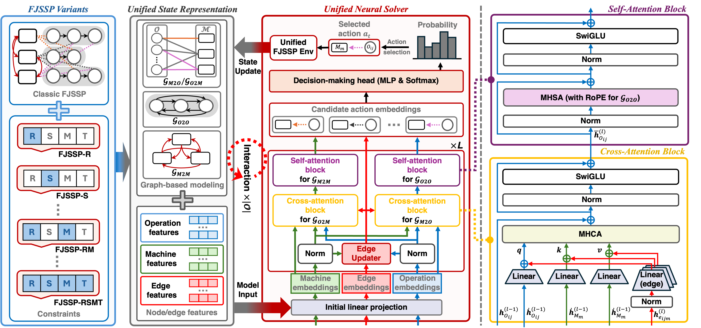

<h1 align="center">
Towards a Unified Model for 
  
Flexible Job Shop Scheduling with Diverse Constraints
</h1>

  
  
  

>This repository is the official implementation of our paper "**Towards a Unified Model for Flexible Job Shop Scheduling with Diverse Constraints**", The Fortieth Annual Conference on Neural Information Processing Systems (NeurIPS 2026).
>The code builds upon [DAN](https://github.com/wrqccc/fjsp-drl) repository.

  

## Abstract

Deep learning-based heuristics have shown great promise for solving the Flexible Job Shop Scheduling Problem (FJSSP). However, existing studies typically overlook operational constraints prevalent in real-world industries or target only a specific FJSSP variant, limiting their practical applicability. In this paper, we introduce SchedFormer, a multi-task scheduling agent that solves FJSSP variants with diverse constraints and generalizes zero-shot to those unseen during training. To support a range of variants within a common framework, we propose a Unified State Representation (USR) that maps different types of constraints into a shared feature space encoding their combined temporal effects, and captures invariant operation-machine relationships across variants via four semantically distinct graphs. To fully exploit the structure of the USR, we also develop a unified neural solver with graph-specific Transformer blocks.
Each block employs an attention mechanism specialized for its target graph, while the mapped constraint information conditions the overall representation learning. Experiments on 16 FJSSP variants show that SchedFormer compares favorably with baselines, including specialized neural solvers, and generalizes very well to unseen variants. Further experiments demonstrate its applicability to other scheduling problems.

## FJSSP variants

| Tag | Constraint | 
|-----|------------|
| `R` | Release dates | 
| `S` | Sequence-dependent setup times | 
| `M` | Machine maintenance | 
| `T` | Transportation times |

Any subset can be combined, giving **16 variants** from `FJSSP` (no constraints) up to
`FJSSP-RSMT` (all four). Our code will be released soon. Stay tuned! 😍
